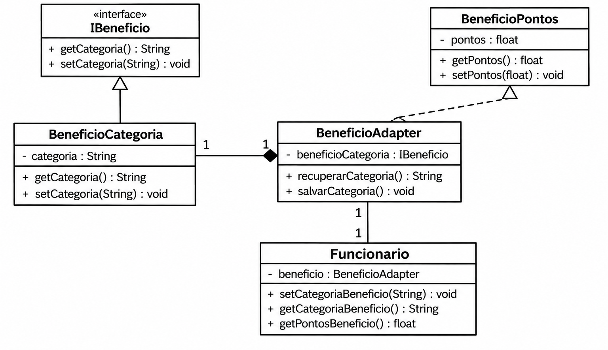

# Padrão de Projeto: Adapter (Sistema de RH)

Projeto em Java exemplificando a aplicação do padrão estrutural **Adapter** no contexto de um sistema de benefícios de Recursos Humanos para a disciplina DCC078-2026.3-A - Aspectos Avançados em Engenharia de Software.

## Diagrama de Classes UML

## Padrão Utilizado

O padrão Adapter permite integrar classes com interfaces incompatíveis. Neste projeto, o `BeneficioAdapter` adapta a representação de categorias de benefícios (`A`, `B`, `C` e `D`) para uma representação numérica em pontos, utilizada por um sistema legado. Dessa forma, o funcionário pode trabalhar com categorias enquanto o sistema legado utiliza valores numéricos, sem precisar alterar sua implementação.

## Estrutura

- `IBeneficio`: interface que define os métodos para consultar e alterar a categoria do benefício.
- `BeneficioCategoria`: implementa a representação do benefício por categoria.
- `BeneficioPontos`: classe do sistema legado que armazena a pontuação numérica.
- `BeneficioAdapter`: adapta as categorias para pontos e os pontos para categorias.
- `Funcionario`: utiliza o Adapter para registrar e consultar a categoria e a pontuação do benefício.
- `FuncionarioTest`: realiza os testes automatizados.